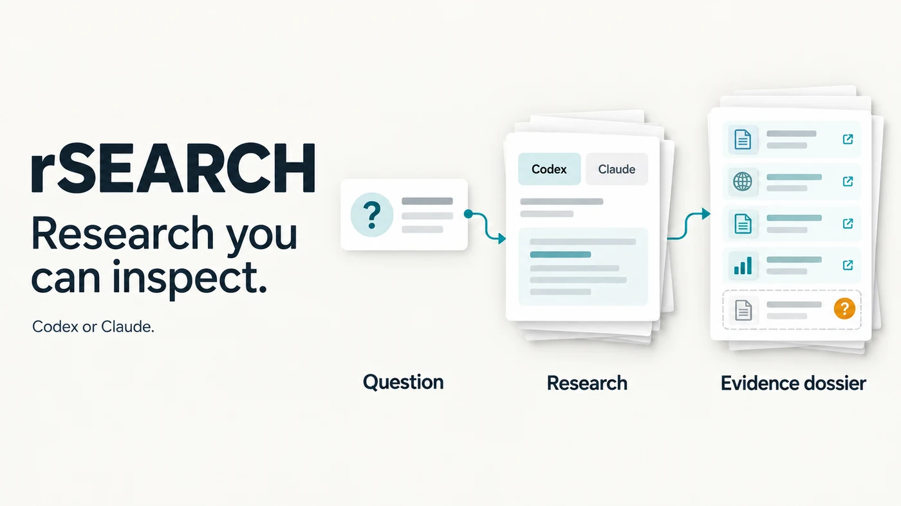
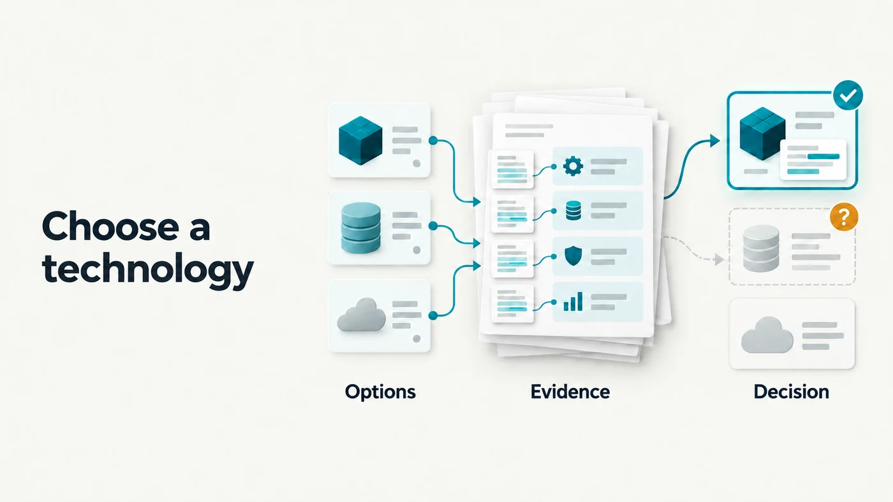
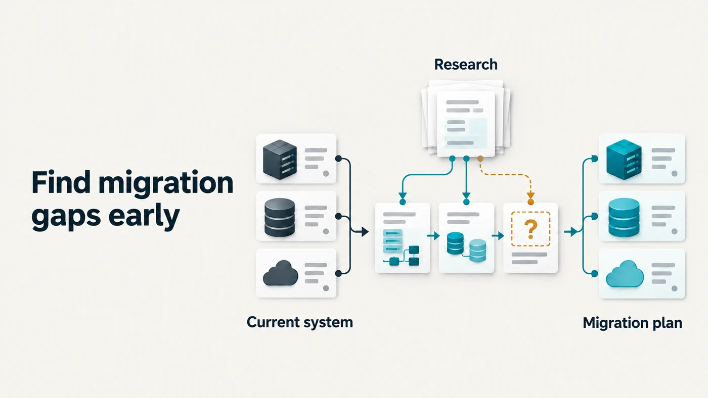
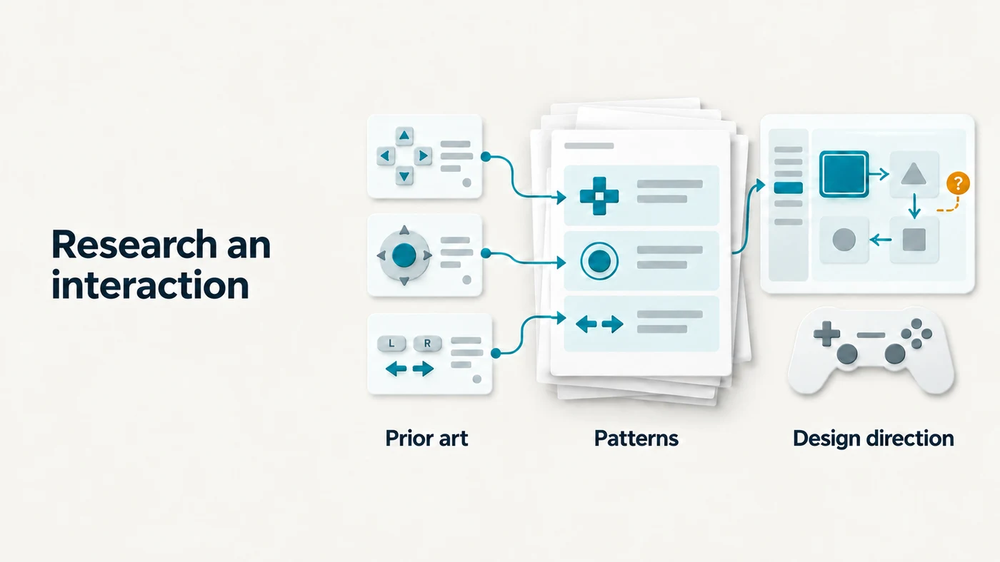
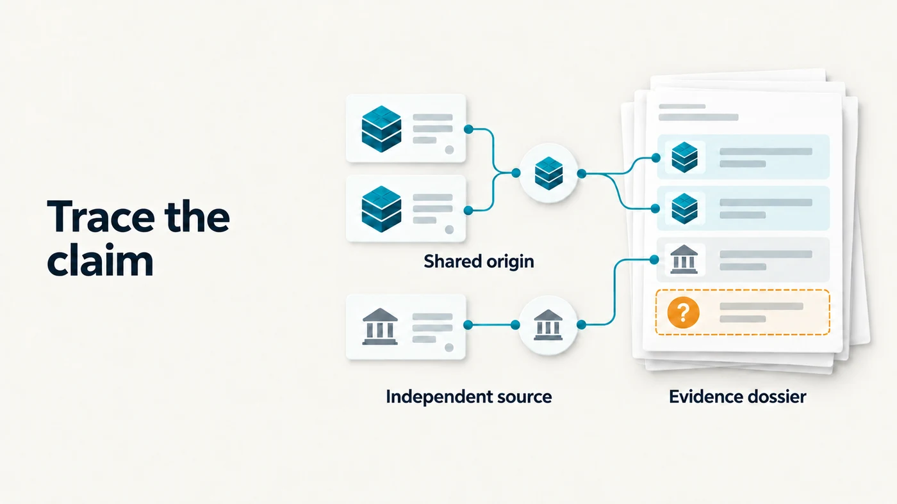

# rSEARCH

**Research you can inspect.**

Turn a focused question into a source-linked report with explicit evidence
levels, visible gaps, and a record of the research performed.

**Use Codex or Claude.** Choose your provider, give it a brief, and get a dossier
you can read, challenge, and use in your next decision.



[Get started](#get-started) · [Download v0.2.0](https://github.com/frdyx/rSEARCH/releases/tag/v0.2.0) · [Installation guide](docs/installation.md) · [How it works](#how-it-works)

[](https://github.com/frdyx/rSEARCH/actions/workflows/ci.yml)
[](LICENSE)

## Make the next decision with clearer evidence

AI answers can look convincing before any research happens. rSEARCH records
completed retrieval operations instead of trusting a worker to say it searched.
A separate verifier assigns evidence levels and keeps uncertainty visible.

It helps you narrow the question, inspect the sources, and hand off a readable
result without reconstructing a long chat. It does not automatically prove a
claim true or guarantee that a citation supports it.

<table>
<tr>
<td width="50%">

<h3>Choose a technology</h3>
<p>Check capabilities, compatibility, and licence sources before you commit to a dependency.</p>
</td>
<td width="50%">

<h3>Find migration gaps early</h3>
<p>Separate documented constraints from assumptions that still need investigation.</p>
</td>
</tr>
<tr>
<td>

<h3>Research an interaction</h3>
<p>Use prior art to inform a design direction, with questions left visible for later testing.</p>
</td>
<td>

<h3>Trace the claim</h3>
<p>Audit sources and distinguish independent support from one origin repeated.</p>
</td>
</tr>
</table>

## What you receive

Each successful run saves a readable **`dossier.md`** and its structured
**`dossier.json`** counterpart, plus the brief, candidate findings, provider
event log, and run metadata.

A finding looks like this:

> **Claim:** The named API returns the current working directory as a string.
>
> **Source:** Official API documentation.
>
> **Evidence level:** `T3_observed` — cited, without independent-channel corroboration.
>
> **Falsifier:** The documented API returns a different type or value.
>
> **Limit:** Documentation describes the API; it does not establish behaviour in every environment.

This is an illustrative report excerpt. The [first-run brief](examples/first-brief.md)
lets you produce a real dossier against official Node.js documentation.

## Get started

### Pick your environment

| Environment | Installation | Status |
|---|---|---|
| Codex CLI or app | CLI runtime plus optional operator skill/plugin | Native Codex engine; Windows live smoke passed |
| Claude Code | CLI runtime plus optional Claude plugin | Native Claude engine; Windows live smoke passed |
| Claude Desktop | [Desktop extension download](https://github.com/frdyx/rSEARCH/releases/download/v0.2.0/rsearch-0.2.0.mcpb) | Preview: protocol and bundle tested; app installation not yet verified |
| Another app with local MCP support | [Standard MCP configuration](docs/installation.md#other-local-mcp-clients) | Conditional on the client's local-process support |

Standalone use requires **Node.js 22+** and an installed, authenticated
**Codex CLI or Claude Code**. You need only the provider you choose. The desktop
extension bundles the rSEARCH dependencies and uses its host's Node runtime,
but still needs the chosen provider CLI installed and signed in.

Install the versioned CLI package from GitHub Releases:

```bash
npm install --global https://github.com/frdyx/rSEARCH/releases/download/v0.2.0/rsearch-0.2.0.tgz
rsearch doctor --provider claude
```

Use `--provider codex` for Codex. No npm registry publication is involved.
See [installation](docs/installation.md) for provider setup, skill/plugin
installation, source downloads, and desktop configuration.

After installing the runtime, Claude Code users can add the operator with:

```text
/plugin install rsearch --marketplace frdyx/rSEARCH
```

### Run your first brief

Download [first-brief.md](examples/first-brief.md), save it locally, then run:

```bash
rsearch research --provider claude --brief-file first-brief.md
```

For Codex:

```bash
rsearch research --provider codex --brief-file first-brief.md
```

The command prints the path to your Markdown dossier. Open it to see the
findings, sources, evidence levels, falsifiers, and limitations.

If a model configured in your desktop app is not supported by its CLI, choose
an explicit CLI-supported model with `--model <model-id>`. rSEARCH does not
silently switch models or providers.

Start from a [technology comparison](examples/technology-selection.md),
[migration question](examples/migration-planning.md),
[interface research](examples/interface-research.md), or
[source audit](examples/source-audit.md) for your own task.

## How it works


1. **Bound the question.** A brief names the question, scope, sources, and what would count as an answer.
2. **Research with your provider.** A read-only worker searches and returns structured findings.
3. **Check the activity.** At least two completed retrieval operations must be recorded. Failed, partial, and duplicate events do not count.
4. **Grade the evidence.** A separate verifier derives source groups and assigns the final evidence levels.
5. **Read and decide.** The dossier informs your next action; it does not make changes to the studied repository.

| Evidence level | What it means |
|---|---|
| `T1_proposed` | No usable source origin was established. |
| `T3_observed` | Cited evidence without independent-channel corroboration. |
| `T4_corroborated` | Matching claim across different provider channels and source-origin groups; independence still needs review. |
| `T5_verified` | Never assigned automatically in this release. |

Two pages from one publisher do not establish independent support. Neither do
two workers using the same provider. To compare completed runs:

```bash
rsearch corroborate --runs /path/to/codex-run /path/to/claude-run
```

Claims must match after normalization; paraphrases are not silently merged.
Read the [evidence rules](skills/rsearch-operator/references/evidence-contract.md)
and [architecture](docs/architecture.md) for the exact boundaries.

## Common questions

**Do I need both providers?** No. Install and authenticate the one you choose.
Running one provider produces useful observed evidence; independent-channel
corroboration is a separate step.

**Does installing the skill install the engine?** No. Skills supply workflow
instructions. Install the CLI runtime separately, or use the desktop extension,
which includes the local runtime dependencies.

**Can it run in every AI app?** The instructions use the Agent Skills format.
Full execution needs local process access or local MCP support. A regular chat
or cloud container without the chosen CLI cannot run this workflow unchanged.

**Is research free or guaranteed to be faster?** Provider usage follows your
normal subscription or API terms. Narrow briefs reduce unnecessary work, but
rSEARCH makes no fixed cost, latency, or savings claim. Runs default to a
ten-minute timeout and one active run per research store.

**Where does my data go?** Results are saved locally in your research store.
Your chosen provider receives the brief and any context its worker reads.
Public sources are retrieved over the web. Research logs can contain sensitive
queries or context; review them before sharing. See [data handling](docs/data-handling.md).

**Does a passing gate mean the answer is correct?** No. It establishes recorded
retrieval activity. Citation support, semantic independence, and correctness
still need review. File existence is not proof of a claim about a file.

## Help and contribute

[Open an issue](https://github.com/frdyx/rSEARCH/issues) with the version,
provider, platform, and a minimal example. Review logs before attaching them.

See [CONTRIBUTING.md](CONTRIBUTING.md), the [validation record](docs/validation.md),
and the [release guide](docs/releases.md). Maintained by [FRDY](https://github.com/frdyx).

Licensed under [MIT](LICENSE). Bundled third-party dependencies retain their
own licences; the MCPB manifest schema attribution is in [schemas/MCPB-LICENSE](schemas/MCPB-LICENSE).
