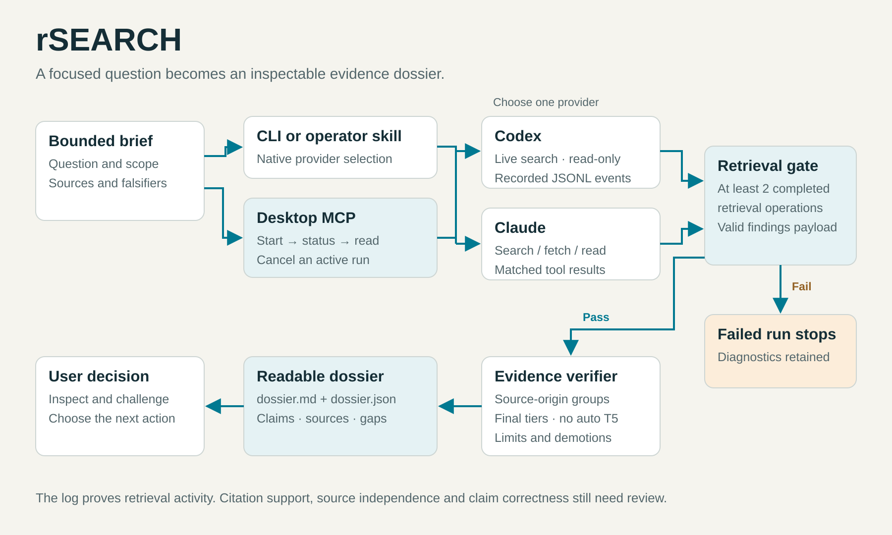

# Runtime and evidence flow

The same Node.js runtime powers the command line and local MCP server.
Provider adapters produce a normalized finding set; a separate verifier grades
it. User instructions and optional skills route into that runtime.

## Provider isolation

Codex runs with live web search, a read-only sandbox, structured output, JSONL
events and ephemeral session storage. Its worker ignores user plugin/hook
configuration and carries only root model and reasoning settings from the user
configuration. An explicit model override takes precedence.

Claude uses restricted non-interactive mode, a whitelist of search/fetch/read
tools, no MCP servers and no persistent session. Only configured model choice
is carried across. Shell, editing and installation tools are not made available.
Provider authentication still belongs to the installed CLI.

Prompts enter through stdin. Arguments use cross-platform spawning so Windows
schema paths and JSON strings survive spaces and shell metacharacters.

## Recorded events

The Codex adapter counts whole `item.completed` events with
`item.type === "web_search"`, a stable operation ID and no failed status.
Started events and partial lines do not count. Repeated IDs are deduplicated.
The final `agent_message` supplies the structured payload.

The Claude adapter matches main-session `assistant` tool-use blocks named
`WebSearch` or `WebFetch` to successful, nonempty `user` tool-result blocks by
operation ID. Partial token events, subagent copies and unmatched results do
not count. The final successful `result.structured_output` supplies findings.

At least two successful completed retrieval operations are required. This is
an activity floor, not a requirement for two independent sources. The runner
also requires a successful provider exit and valid findings.

## Run files

| File | Purpose |
|---|---|
| `brief.md` | The submitted question and scope |
| `finding.schema.json` | Output contract used for this run |
| `provider-stream.jsonl` | Recorded provider events |
| `provider-stderr.txt` | Private diagnostic output |
| `run.json` | State, provider/version, retrieval count, stream digest and errors |
| `findings.json` | Parsed candidate findings |
| `dossier.json` / `dossier.md` | Graded results and readable counterpart |

Run metadata uses `rsearch.run/2`; dossiers use `rsearch.dossier/2`.
Re-verification checks the saved stream digest, reparses retrieval events and
compares findings to the provider payload. Digests detect changes relative to
the stored record; a person controlling all files can replace the record too.

## Evidence levels

Registrable domains approximate external source groups using public suffix
data. Local file citations are resolved with boundary and symlink checks, but
an existing file never earns a verified tier.

Matching whole normalized claims can be combined across completed runs. T4
requires different provider channels and at least two external source groups.
A second run on the same provider does not create another channel. Semantic
independence and citation support remain review tasks. Automatic T5 is disabled.

See [the evidence contract](../skills/rsearch-operator/references/evidence-contract.md).

## Lifecycle and storage

One active run is allowed per store. A process-owned lock prevents another CLI
or MCP run from using the same store concurrently. An interrupted owner's lock
can be recovered. Default timeout is 600 seconds, configurable from 1 to 3600.
Cancellation stops the owned provider process and retains diagnostics.

Default storage is `%LOCALAPPDATA%/rsearch` on Windows,
`~/Library/Application Support/rsearch` on macOS, and
`${XDG_DATA_HOME:-~/.local/share}/rsearch` on Linux. `RSEARCH_HOME` overrides it;
`--out` is the explicit command override. Environment redirection applies when
the runtime runs inside a packaged desktop or sandbox host.

Output is rejected inside the studied repository. MCP repository access must
be inside configured readable roots. Run IDs and canonical file paths constrain
result reads to the configured research store. No arbitrary command execution
tool or global-configuration mutation is exposed by the MCP server.
